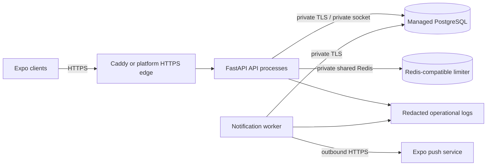

# Production architecture proposal

Status: design only. No provider account, environment, domain, database, Redis
instance, credential, or deployment was created or selected in Phase 2g.2.

## Recommended shape

Run the API and notification worker as separate long-lived services in one
region. Put an HTTPS edge in front of the API; keep the worker private with no
inbound route. Use a managed PostgreSQL database and one private Redis-compatible
service shared by every API process for atomic quotas. The worker uses PostgreSQL
and outbound HTTPS to Expo. Do not make the database, Redis, worker, or admin
surface publicly reachable.

Use distinct staging and production projects/environments. Each has its own API,
worker, PostgreSQL database, Redis instance, database roles, secret set, push
credentials, domain and deployment permission group. Staging data must be
synthetic; do not restore production data into staging. Promote an immutable
build artifact after staging tests rather than rebuilding different source for
production.

The lowest-operations launch path is a same-region application platform with
managed PostgreSQL and managed Redis-compatible storage. Keep one API service
and one worker initially, then scale API instances horizontally only after
load and database-pool measurements. Keep database and limiter storage private.
Use a paid PostgreSQL tier with point-in-time recovery; do not use expiring/free
databases for production. The initial single-region design has a regional
failure domain. High availability and a second region require an explicit RTO,
RPO, budget and data-residency decision.

## Provider options (not selected)

| Option | Fit | Trade-offs and required checks |
|---|---|---|
| Render | One platform offers web services, background workers, PostgreSQL, Redis-compatible Key Value, same-region private networking, environment-scoped secrets, and managed TLS. This is the simplest operations model for the current two-process backend. | Verify database/Key Value plan cost, backup recovery window, region, eviction policy, support and secret/environment permissions before purchase. Render private connections use service hostnames. **The current backend rejects DNS hostnames in `RATE_LIMIT_REDIS_URL`**, so its Key Value URL cannot be used until an approved application change safely supports the provider's private hostname, or a reviewed private proxy supplies an allowed endpoint. Do not work around this with a public endpoint. [Private networking](https://render.com/docs/private-network), [background workers](https://render.com/docs/background-workers), [PostgreSQL backups](https://render.com/docs/postgresql-backups), [TLS](https://render.com/docs/tls). |
| DigitalOcean App Platform + Managed PostgreSQL + Managed Valkey | App Platform can connect to VPC resources; Managed PostgreSQL and Valkey provide managed datastore operations, private-network controls and Redis-client compatibility. | Requires VPC and trusted-source configuration across the app and datastores. Managed endpoints use DNS; the same `RATE_LIMIT_REDIS_URL` hostname restriction blocks direct Valkey use until resolved. Current published starting prices are approximately USD 15.15/month for the smallest PostgreSQL node and USD 15/month for Valkey, before App Platform compute, storage, backups, taxes or higher availability; recheck the live quote. [App Platform VPC](https://docs.digitalocean.com/products/app-platform/how-to/enable-vpc/), [PostgreSQL](https://www.digitalocean.com/products/managed-databases-postgresql), [Valkey](https://www.digitalocean.com/products/managed-databases-valkey), [database pricing](https://www.digitalocean.com/pricing/managed-databases). |

Prices and features change. These are candidates, not procurement advice. Select a
provider only after testing private connectivity, PostgreSQL TLS verification,
Redis endpoint compatibility, backup retention and recovery, service-region
availability, contractual privacy terms, data residency and total monthly cost.
Do not select a hosting provider from an example file.

## Compatibility gates found in the repository

- The application requires production Redis and validates `RATE_LIMIT_REDIS_URL`
  as an absolute Unix socket or private literal IP/localhost. Arbitrary DNS
  names are intentionally rejected. Managed private datastores commonly expose
  DNS hostnames, so direct managed Redis/Valkey integration is currently blocked.
  The safe follow-up is an explicitly approved design for trusted private DNS
  endpoints with TLS/hostname verification and endpoint restrictions, plus
  tests for public-host rejection and DNS changes. Never weaken this by trusting
  user-controlled forwarding or a public Redis URL.
- `GET /health` is process liveness only. The API lifespan fails startup if
  Redis cannot be reached, but it does not check PostgreSQL at startup and
  `/health` remains 200 during later dependency failure. `/admin/ops/health`
  gives richer data only when the admin surface is enabled and a verified admin
  session is supplied. There is no unauthenticated dependency-readiness route;
  deployment probes must not mistake `/health` for readiness.
- Database URLs accept PostgreSQL through the configured SQLAlchemy driver and
  the connection timeout is bounded. Configure the provider's CA and
  `sslmode=verify-full` (or its documented equivalent), private endpoint and
  certificate validation. PostgreSQL pools are now bounded to 5 persistent
  connections plus 2 overflow connections per process, with a 10-second pool
  wait, 30-minute recycle and pre-ping. At the example's two API workers plus
  one worker process this is up to 21 connections; a simultaneous one-shot
  migration process can raise the transient maximum to 28. Calculate the total
  for all replicas and reserve provider capacity before choosing a small
  database tier. Do not disable certificate checks to resolve a connectivity
  issue.
- The notification worker is a distinct executable and does not start with the
  API. It requires its own process supervision and production notification
  configuration. Current shared settings import also requires `JWT_SECRET_KEY`
  in the worker environment even though the worker does not issue access
  tokens. Treat this as an unnecessary key exposure to resolve before production
  secret scoping; do not give the worker the API signing key by copying a shared
  all-secrets file without review.
- `/admin/*` is default-off and requires the documented durable-session, role,
  TOTP and audit controls. Keep it disabled until provisioning, monitoring,
  alerting, audit retention and access review are operational. The browser admin
  dashboard is a separate pending project.

## Network and service boundaries

- Public ingress: HTTPS only to the API. Caddy or the selected platform edge
  terminates TLS and enforces the request-body limit. The existing Caddy example
  proxies to loopback, overwrites forwarding headers and has access logs off.
- API: no direct public listener behind Caddy; bind to loopback on a VPS. Use
  Uvicorn proxy-header support with only the actual Caddy peer trusted. In a
  platform deployment, determine the proxy peer range and use only that exact
  documented range. Never set trusted proxy IPs to `*`; the limiter ignores
  client-supplied `X-Forwarded-For` unless Uvicorn's trusted boundary replaces
  the ASGI peer address.
- PostgreSQL: no public unrestricted ingress. Prefer same-provider private
  networking. If cross-provider access is unavoidable, require TLS certificate
  validation, static egress IP allowlisting, unique strong credentials and
  documented exposure review. No superuser for runtime.
- Redis: one shared, private, non-evicting limiter store for all API workers.
  Never expose port 6379 publicly. Use a Unix socket with strict group
  permissions on a single host, or authenticated TLS over a private network.
  An in-memory limiter is forbidden in production. Size memory and alert on
  evictions; any evicted quota state can weaken enforcement.
- Worker: no inbound public port. Allow outbound database traffic and HTTPS to
  the chosen push provider only as needed. Never log push payloads or tokens.
- CORS is intentionally closed. Native mobile bearer-token calls do not need
  browser CORS. If a browser admin UI is later approved, add a precise HTTPS
  origin allowlist in a separate security review; never use wildcard origins
  with credentials.

## Environment separation

Use secret-manager scopes that are isolated by environment and service. Store
blank templates only in Git. The production and staging examples are contracts,
not loadable secret bundles. Required unique secrets include the JWT signing
key, rate-limit HMAC key, refresh-receipt key, push-token encryption key and,
when admin is enabled, TOTP encryption key. Do not reuse values across keys,
services or environments. Scope Expo credentials to the environment/project and
keep them only on the worker where possible.

Maintain different deployment roles: developers may read staging logs/config;
only a small release group may deploy production; only designated operators may
view production secret values or database credentials. Require MFA on hosting,
DNS, registry, backup, monitoring and source-control accounts. Review provider
audit logs for secret access and role changes. Keep break-glass access sealed,
time-limited and tested.

The production example uses a local Redis socket for the compatible single-host
fallback. It is not a Render/DO managed Redis URL template. No provider-specific
resource manifest is included until the provider and the Redis hostname gate
are resolved.
